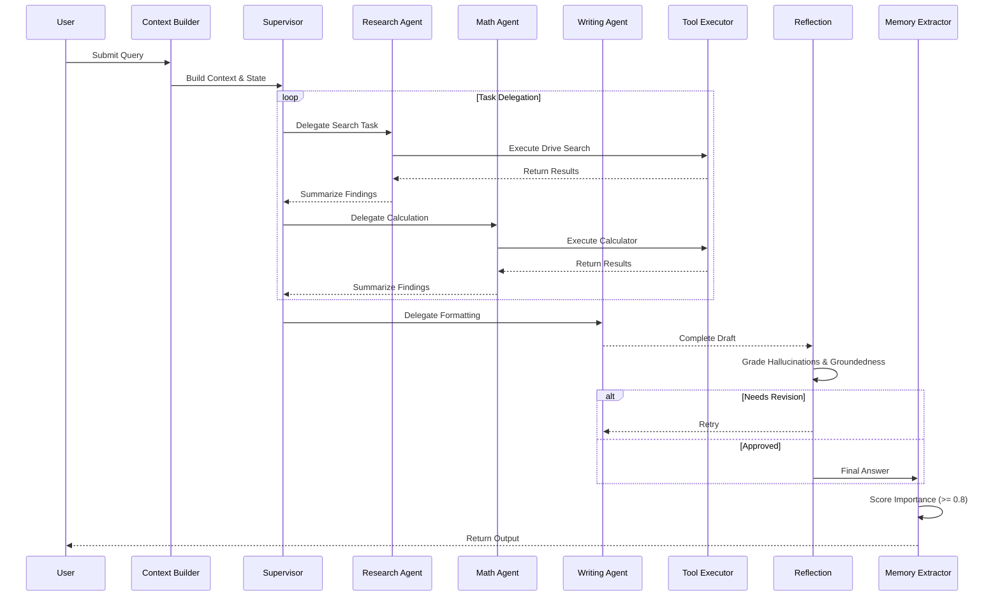
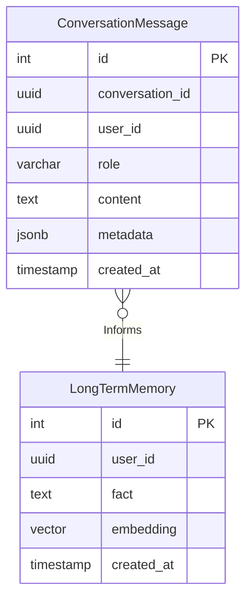
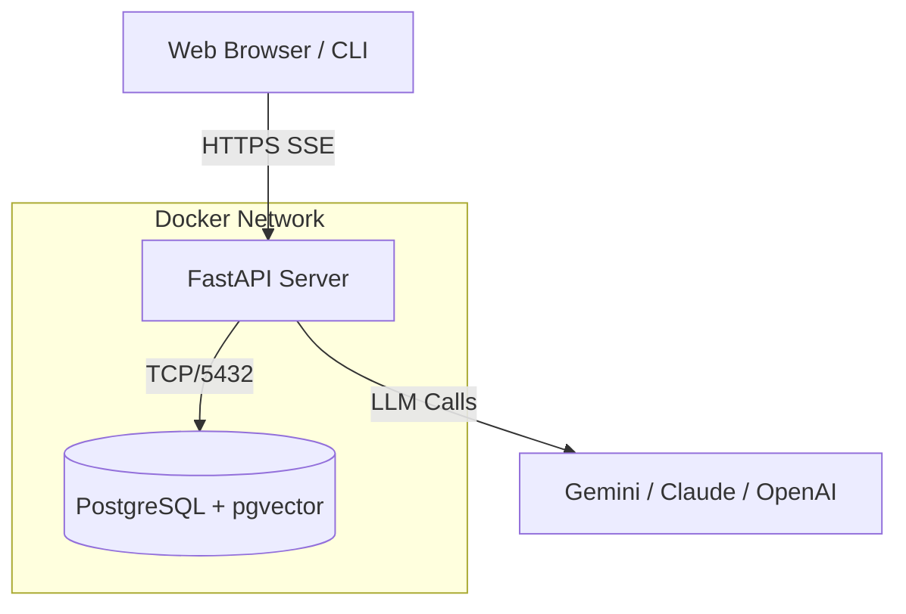

# Architecture Documentation

## Workflow Sequence (LangGraph)
The core intelligence of the OS is driven by a Multi-Agent Supervisor pattern implemented via LangGraph.

## Database Schema (pgvector)

## Deployment Topology

